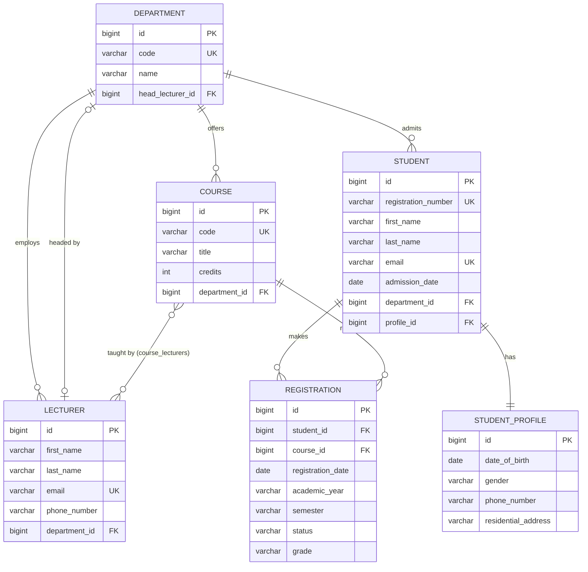
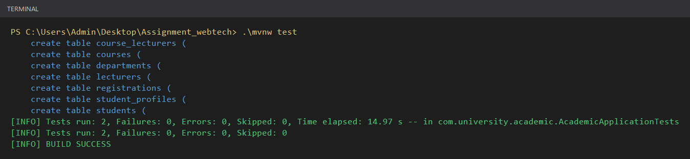
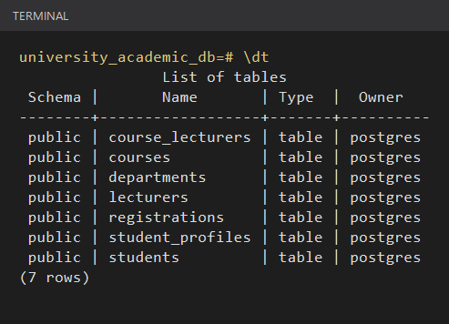
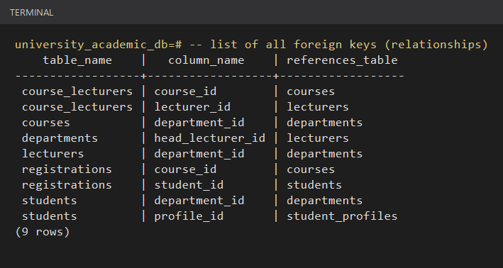
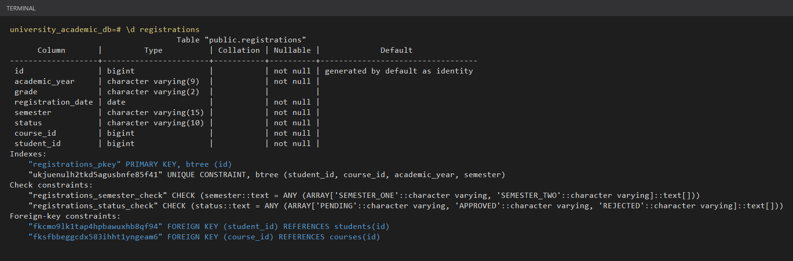

# University Course Registration and Academic Management System

Web Technology and Internet: Individual Assignment
Stack: Spring Boot, Spring Data JPA / Hibernate, PostgreSQL, Maven, Java 17

This stage covers the **Model** and **Repository** layers only.

---

## 1. Problem Analysis

### Entities and why I picked them

| Entity | Why it is an entity |
|---|---|
| **Department** | The university is organised into departments. Each one has its own courses, lecturers, students and a head. |
| **Lecturer** | Lecturers belong to a department, teach courses and one of them heads the department. |
| **Course** | Courses are offered by a department, taught by lecturers and registered for by students. |
| **Student** | Students are admitted into a department and register for courses. |
| **StudentProfile** | The personal details (date of birth, gender, phone, address) are kept apart from the main student record. Each student has exactly one profile. |
| **Registration** | A student registering for a course has its own data (date, academic year, semester, status, grade), so it needs to be an entity of its own. |

Enums (not tables): `Gender` (MALE, FEMALE), `Semester` (SEMESTER_ONE, SEMESTER_TWO), `RegistrationStatus` (PENDING, APPROVED, REJECTED).

### Attributes

| Entity | Attributes |
|---|---|
| Department | id, code, name, head (lecturer) |
| Lecturer | id, firstName, lastName, email, phoneNumber, department |
| Course | id, code, title, credits, department |
| Student | id, registrationNumber, firstName, lastName, email, admissionDate, department, profile |
| StudentProfile | id, dateOfBirth, gender, phoneNumber, residentialAddress |
| Registration | id, student, course, registrationDate, academicYear, semester, status, grade |

### Relationships and cardinality

| # | Relationship | Cardinality | How it is stored |
|---|---|---|---|
| 1 | Department **employs** Lecturer | 1 : N | Foreign key `lecturers.department_id` |
| 2 | Lecturer **heads** Department | 1 : 1 | Foreign key `departments.head_lecturer_id` (unique) |
| 3 | Department **offers** Course | 1 : N | Foreign key `courses.department_id` |
| 4 | Department **admits** Student | 1 : N | Foreign key `students.department_id` |
| 5 | Student **has** StudentProfile | 1 : 1 | Foreign key `students.profile_id` (unique) |
| 6 | Lecturer **teaches** Course | M : N | **Join table** `course_lecturers` |
| 7 | Student **registers for** Course | M : N | **Join entity** `Registration` (table `registrations`) |

- **Foreign keys:** relationships 1 to 5. In a one-to-many the key goes on the "many" side. In a one-to-one it can go on either side; I put it where it reads most naturally (the department points to its head, the student points to its profile).
- **Join table (no entity):** Lecturer and Course. The assignment only needs to know *who teaches what*, with no extra data, so a plain `@ManyToMany` with `@JoinTable` is enough, as the brief asks.
- **Join entity:** Student and Course. Each registration has its own data (date, academic year, semester, status, grade). A plain join table can only hold the two keys, so this has to be a proper entity with two `@ManyToOne` links.

---

## 2. Entity Relationship Diagram



---

## 3. Relational Database Schema

Database: `university_academic_db`

```
departments      (id PK, code UNIQUE, name, head_lecturer_id FK -> lecturers.id UNIQUE)
lecturers        (id PK, first_name, last_name, email UNIQUE, phone_number,
                  department_id FK -> departments.id)
courses          (id PK, code UNIQUE, title, credits, department_id FK -> departments.id)
student_profiles (id PK, date_of_birth, gender, phone_number, residential_address)
students         (id PK, registration_number UNIQUE, first_name, last_name, email UNIQUE,
                  admission_date, department_id FK -> departments.id,
                  profile_id FK -> student_profiles.id UNIQUE)
course_lecturers (course_id FK -> courses.id, lecturer_id FK -> lecturers.id)
registrations    (id PK, student_id FK -> students.id, course_id FK -> courses.id,
                  registration_date, academic_year, semester, status, grade,
                  UNIQUE(student_id, course_id, academic_year, semester))
```

The unique key on `registrations` stops a student from registering for the same course twice in the same semester.

---

## 4. Project Structure

```
src/main/java/com/university/academic
├── AcademicApplication.java
├── model
│   ├── Department.java
│   ├── Lecturer.java
│   ├── Course.java
│   ├── Student.java
│   ├── StudentProfile.java
│   ├── Registration.java
│   ├── Gender.java
│   ├── Semester.java
│   └── RegistrationStatus.java
└── repository
    ├── DepartmentRepository.java
    ├── LecturerRepository.java
    ├── CourseRepository.java
    ├── StudentRepository.java
    ├── StudentProfileRepository.java
    └── RegistrationRepository.java
```

---

## 5. How to Run

1. Create the database in PostgreSQL:
   ```sql
   CREATE DATABASE university_academic_db;
   ```
2. Set your PostgreSQL username and password in `src/main/resources/application.properties`.
3. Run the application. Hibernate creates all the tables (`ddl-auto=update`):
   ```
   ./mvnw spring-boot:run
   ```
4. Run the mapping test. It saves a department, lecturers, a course, a student with a profile and a registration, then reads them back. It rolls back afterwards.
   ```
   ./mvnw test
   ```

---

## 6. Screenshots

**Hibernate creating the tables, and the mapping tests passing**



**The 7 tables generated in `university_academic_db`**



**All foreign keys (the relationships)**



**The `registrations` join entity, with its own columns, unique key and foreign keys**


